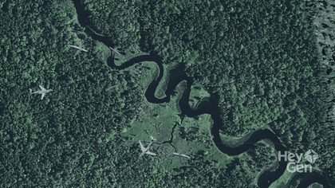
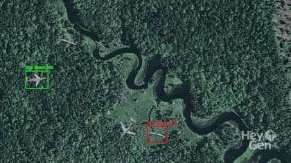

# TALOS — Tactical Aerospace Localization & Objective Scoring

TALOS finds aircraft in overhead imagery, follows each one across frames, and ranks them by how threatening their motion looks relative to a protected point.

It is three pieces chained together:

1. **Detect** — a fine-tuned YOLO26s model finds every aircraft in a frame.
2. **Track** — a Kalman filter per aircraft plus Hungarian assignment keeps a stable ID on each one.
3. **Score** — a threat engine turns each track's position, velocity and filter confidence into a risk score between 0 and 1.

The output is an annotated video and a CSV log of the highest-risk tracks.

## Demo

| Raw input | TALOS output |
| :---: | :---: |
|  |  |

Each box carries a track ID and its current risk score. The red box is the highest-risk aircraft in that frame; the rest are green.

The clip is a 5-second, 1280×720, 25 fps synthetic test video (125 frames). TALOS processes recorded video offline: on a laptop CPU this clip takes about 25 seconds, roughly 5 frames per second.

## How it works

### Detection

| | |
| --- | --- |
| Model | YOLO26s (Ultralytics), fine-tuned from `yolo26s.pt` |
| Dataset | [CGI Planes in Satellite Imagery](https://www.kaggle.com/datasets/aceofspades914/cgi-planes-in-satellite-imagery-w-bboxes) — 400 training and 100 validation images, one class (`plane`) |
| Training | 1 epoch, image size 1024, batch 8, CPU (about 16 minutes) |
| Validation | mAP50 **0.921**, mAP50-95 **0.572**, precision 0.869, recall 0.834 |

Annotations ship as Pascal VOC XML; the transformation stage converts them to YOLO format. Detections below 0.5 confidence are dropped at inference.

### Tracking

Every aircraft gets its own Kalman filter with a constant-velocity motion model over the state

$$x = [\,c_x,\ c_y,\ v_x,\ v_y,\ w,\ h\,]$$

On each frame all filters predict forward, then the Hungarian algorithm (`scipy.optimize.linear_sum_assignment`) matches predictions to new detections by minimising the total Euclidean distance over $(c_x, c_y, w, h)$. A match is accepted only if its cost is under 150 px. Matched tracks are corrected with the detection; unmatched detections start new tracks.

### Threat scoring

Each track is scored against a protected origin — currently the top-left corner of the frame, `(0, 0)`. With $d$ the distance to the origin and $v_{close}$ the component of velocity pointing at it:

| Term | Formula | Meaning |
| --- | --- | --- |
| Urgency | $e^{-TTI/\tau}$, where $TTI = d / v_{close}$ and $\tau = 5$ | How soon it would arrive. Zero unless it is closing. |
| Proximity | $e^{-d/800}$ | How close it already is. |
| Intent | $\max(0,\ \cos\theta)$ between velocity and the direction to the origin | Whether it is heading at the origin. |
| Certainty | $e^{-\mathrm{Tr}(P_{pos})/100}$ | How settled the filter's position estimate is. |

$$S = 0.4\,\text{Urgency} + 0.3\,\text{Proximity} + 0.2\,\text{Intent} + 0.1\,\text{Certainty}$$

All distances and speeds are in pixels, not ground units.

## Run it

Requires Python 3.11 or newer.

```bash
git clone https://github.com/Gakshith/Tactical-Aerospace-Localization-Objective-Scoring-TALOS-.git
cd Tactical-Aerospace-Localization-Objective-Scoring-TALOS-
pip install -r requirements.txt
```

Put the video you want analysed at `source_video/input.mp4`, then run the whole pipeline:

```bash
python main.py
```

The first run downloads the dataset through `kagglehub` and trains the detector, so it takes a while. Trained weights are not stored in the repository.

Results land in `artifacts/model_run/`:

| File | Contents |
| --- | --- |
| `Output.mp4` | The input video with boxes, track IDs and risk scores drawn on |
| `talos_threat_analysis.csv` | The five highest-risk tracks every 30 frames: `frame, id, score, tti` |

A `tti` of `999` means the track is not closing on the origin.

To re-run only the tracking and scoring on a new video, once `artifacts/model_trainer/best.pt` exists:

```bash
python -m src.TALOS.pipeline.stage_05_model_run
```

## Pipeline stages

`main.py` runs five stages in order. Paths and training settings live in [`config/config.yaml`](config/config.yaml).

| # | Stage | What it does | Writes to |
| --- | --- | --- | --- |
| 1 | Data ingestion | Downloads the Kaggle dataset | `artifacts/data_ingestion/` |
| 2 | Data validation | Checks every image has a matching annotation file | `artifacts/data_validation/status.txt` |
| 3 | Data transformation | Converts VOC XML to YOLO labels and writes the dataset YAML | `artifacts/data_transformation/` |
| 4 | Model training | Fine-tunes YOLO26s and keeps the best weights | `artifacts/model_trainer/best.pt` |
| 5 | Model run | Detects, tracks and scores the input video | `artifacts/model_run/` |

Stage 4 skips training when a `runs/` folder already exists, and collects weights from `runs/detect/train/`. Delete `runs/` to retrain from scratch.

## Repository layout

```
config/config.yaml        paths and training settings
main.py                   runs all five stages
src/TALOS/
  components/             the logic for each stage
  pipeline/               one runnable entry point per stage
  config/  entity/        typed configuration
  utils/                  YAML, JSON and filesystem helpers
research/                 notebooks each stage was prototyped in
dags/talos_dag.py         the same five stages as an Airflow DAG
airflow/                  docker-compose stack for Airflow
Dockerfile                container that runs main.py
.github/workflows/        CI checks, plus a manual build-and-deploy to AWS ECR/EC2
```

## Known limitations

- **Tracks never retire.** A track that loses its aircraft stays on screen at its last position, which can leave a second box over the same plane. Frames with no detections skip the predict step entirely.
- **Fixed frame rate.** The filter assumes 30 fps regardless of the video's real frame rate, so estimated speeds are off by that ratio.
- **Fixed origin.** The protected point is hard-coded to the frame's top-left corner.
- **Lightly trained detector.** One epoch on 500 computer-generated images; expect weaker results on real satellite footage.
- **Deployment is not wired up.** The Airflow stack does not yet mount this repo's `dags/` and `src/`, and the AWS delivery jobs need repository secrets that are not configured.

## License

[MIT](LICENSE)
