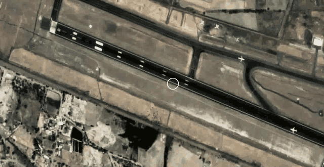

# TALOS — Tactical Aerospace Localization & Objective Scoring

[](https://github.com/Gakshith/Tactical-Aerospace-Localization-Objective-Scoring-TALOS-/actions/workflows/ci.yml)

TALOS detects aircraft and ships in satellite video, keeps a stable ID on each one, and estimates the probability that each will enter a protected zone within the next 10 seconds. An operator gets a warning before the zone is reached.

**Live demo:** [huggingface.co/spaces/dustin-demo/talos-satellite-tracking](https://huggingface.co/spaces/dustin-demo/talos-satellite-tracking). It shows 8 clips from VISO, a satellite dataset the model never trained on, with the misses included.



<sub>VISO clip 039, CC BY-NC-SA 4.0 (Yin et al., IEEE TGRS 2021); this annotated GIF is shared under the same license. The plane heading down the runway is flagged 7.3 s before it enters the zone.</sub>

## What it does

| Stage | Method |
|---|---|
| **Detect** | YOLO26s fine-tuned on 1024 px tiles of real Jilin-1 video. The NMS-free end-to-end head runs, and an edge-aware merge rejoins aircraft cut by tile borders. |
| **Track** | TALOS-Track: a Kalman filter per object (state `cx, cy, vx, vy, w, h`). It adds a tentative/confirmed/lost lifecycle, the real time step, Mahalanobis χ² gating, two-stage (high/low confidence) association, OC-SORT-style re-update and duplicate-track suppression. Measurement noise is calibrated from detector errors. |
| **Threat** | P(enter zone within 10 s): Monte Carlo rollouts from each track's state and covariance. Motion noise is fitted on train by Brier score, and the alert threshold is the 5%-false-alarm point on val. |

Per-stage timings are in [Speed](#speed): detection is nearly all the cost.

Every number in this README comes from a JSON file in [`results/`](results/) written by a Slurm job, and the tables are regenerated by [`scripts/readme_tables.py`](scripts/readme_tables.py). The test split was used once per final configuration, and each use is logged in [`results/TEST_LOG.md`](results/TEST_LOG.md).

## Data

| Dataset | Use | Notes |
|---|---|---|
| [AIR-MOT-100](https://github.com/HeQibin/TGraM) (He et al., IEEE TGRS 2022) | train / val / test | 69 annotated Jilin-1 videos at 1920×1080, aircraft and ships, split 47/11/11 by video. The split is frozen in [`configs/splits/airmot.json`](configs/splits/airmot.json). No license is stated, so no frames are redistributed. See [`docs/data/airmot.md`](docs/data/airmot.md). |
| [VISO](https://github.com/QingyongHu/VISO) (Yin et al., IEEE TGRS 2021) | cross-dataset check only | CC BY-NC-SA 4.0. It labels only moving objects. See [`docs/data/viso.md`](docs/data/viso.md). |

AIR-MOT does not state a frame rate; 10 fps is assumed throughout. Distances are in pixels.

## Results

### Tracking against published trackers

Every tracker gets the same detections and the same tuning budget: 30 random configs on val, scored with [TrackEval](https://github.com/JonathonLuiten/TrackEval) HOTA. Best value per column in bold.

<!-- table:tracking -->
**Aircraft** (AIR-MOT test, 5 videos)

| tracker | HOTA | IDF1 | MOTA | AssA | ID switches |
| --- | ---: | ---: | ---: | ---: | ---: |
| TALOS v1 | 64.1 | 76.8 | 46.5 | 81.8 | 5 |
| SORT | 69.3 | 85.2 | 77.0 | 76.7 | 47 |
| ByteTrack | 73.2 | 88.7 | 86.2 | 78.9 | 42 |
| OC-SORT | 71.9 | 87.4 | 88.3 | 74.9 | 36 |
| BoT-SORT | 75.0 | 92.4 | 86.4 | 82.7 | 3 |
| **TALOS-Track** | **77.4** | **96.4** | **92.6** | **83.8** | 0 |

**Ships** (AIR-MOT test, 7 videos)

| tracker | HOTA | IDF1 | MOTA | AssA | ID switches |
| --- | ---: | ---: | ---: | ---: | ---: |
| TALOS v1 | 48.1 | 59.6 | -7.3 | **71.3** | 5 |
| SORT | 42.6 | 50.6 | 8.5 | 54.2 | 118 |
| ByteTrack | 51.7 | 66.7 | 29.1 | 69.8 | 17 |
| OC-SORT | 47.5 | 63.6 | 34.1 | 62.0 | 31 |
| BoT-SORT | 52.3 | 68.4 | **38.6** | 69.4 | 7 |
| **TALOS-Track** | **52.9** | **68.8** | 37.6 | 69.7 | 12 |

The whole v1 system (its own detector and tracker) scores **0.0 HOTA** on the same aircraft test videos: its detector, trained on synthetic images, finds almost nothing in real satellite video.
<!-- /table:tracking -->

On aircraft, TALOS-Track is best on every column, with no ID switches. On ships it edges BoT-SORT on HOTA and IDF1 but trails it on MOTA and has more ID switches (12 vs 7); v1 has the highest ship AssA because it keeps few, long tracks. Ship scores are low for every tracker because the detector's ship precision is low (see below).

**Fair baselines matter.** How much depends on the detector. With the final detector, tuning moves HOTA only a few points. With the earlier, noisier YOLO26m detections, library defaults understated some baselines by up to 24 HOTA, so comparing against untuned baselines would have flattered TALOS-Track:

<!-- table:tuning -->
| val HOTA, defaults → tuned | final detector (YOLO26s, 1024 tiles) | gain | earlier detector (YOLO26m, 640 tiles) | gain |
| --- | ---: | ---: | ---: | ---: |
| SORT (planes) | 61.0 → 62.9 | +1.9 | 58.8 → 60.5 | +1.8 |
| ByteTrack (planes) | 66.1 → 66.1 | +0.0 | 58.0 → 62.3 | +4.4 |
| OC-SORT (planes) | 67.2 → 67.2 | +0.0 | 50.3 → 58.6 | +8.4 |
| BoT-SORT (planes) | 67.4 → 68.4 | +1.0 | 56.5 → 61.4 | +5.0 |
| **TALOS-Track** (planes) | 66.7 → 67.7 | +1.0 | 61.5 → 62.4 | +0.9 |
| SORT (ships) | 29.0 → 36.3 | +7.3 | 38.0 → 41.2 | +3.2 |
| ByteTrack (ships) | 42.6 → 43.4 | +0.7 | 25.5 → 44.4 | +18.9 |
| OC-SORT (ships) | 39.6 → 41.8 | +2.2 | 16.4 → 40.5 | +24.0 |
| BoT-SORT (ships) | 42.7 → 44.8 | +2.0 | 26.0 → 42.4 | +16.5 |
| **TALOS-Track** (ships) | 43.3 → 45.4 | +2.1 | 35.4 → 43.4 | +8.0 |
<!-- /table:tuning -->

**Duplicate-track suppression.** The ID-switch report traced most aircraft ID switches to one cause: a second track born on an aircraft that already had one. Suppressing the younger twin took aircraft ID switches from 49 to 0 on val. On ships it raised ID switches (7 to 20) while HOTA and IDF1 still improved slightly, and so the tuned ship setting suppresses only near-identical twins (a higher overlap threshold than for aircraft).

<!-- table:dedup -->
| val | ID switches before | after | HOTA | IDF1 |
| --- | ---: | ---: | ---: | ---: |
| planes | 49 | 0 | 66.2 → 67.7 | 78.3 → 80.1 |
| ships | 7 | 20 | 44.9 → 45.4 | 53.8 → 55.4 |
<!-- /table:dedup -->

<details><summary>Component ablation (val, early design check)</summary>

Day-3 ablation on AIR-MOT val aircraft. It uses ground-truth boxes degraded with 20% misses, jitter and false positives, with untuned settings and before duplicate suppression existed. Steps are cumulative. The Mahalanobis gate and two-stage association give the largest gains. Lifecycle management and the real time step on their own lower HOTA on these degraded boxes; they pay off only once the gate and the second association stage are in place.

<!-- table:ablation -->
| cumulative step | HOTA | IDF1 | MOTA | ID switches |
| --- | ---: | ---: | ---: | ---: |
| constant-velocity Kalman + Hungarian (v1-like) | 43.4 | 46.2 | -42.9 | 569 |
| + track lifecycle (tentative / confirmed / lost) | 37.3 | 51.3 | 42.2 | 818 |
| + real time step | 31.8 | 40.4 | 41.6 | 835 |
| + Mahalanobis gate | 41.4 | 60.2 | 44.1 | 475 |
| + two-stage (ByteTrack-style) association | 56.9 | 72.9 | 62.7 | 635 |
| + OC-SORT re-update | 56.5 | 72.2 | 61.5 | 772 |
| + coasting output | 61.1 | 76.9 | 64.4 | 183 |
| ByteTrack, same detections | 55.4 | 68.5 | 67.9 | 69 |
<!-- /table:ablation -->
</details>

### Detector

YOLO26s trained on 1024 px tiles was chosen over 640 px tiles, YOLO26m, and 512 px tiles with 2× upsampling, on **full-frame** val AP50. Tile-level validation mAP ranked these models in the wrong order. Recall is reported by object size because that is where tiling choices win or lose.

<!-- table:detector -->
| AIR-MOT | AP50 | precision | recall | recall <16 px | 16–32 px | >32 px |
| --- | ---: | ---: | ---: | ---: | ---: | ---: |
| planes, val | 0.778 | 0.79 | 0.77 | 0.06 | 0.70 | 1.00 |
| ships, val | 0.441 | 0.32 | 0.71 | 0.76 | 0.81 | 0.45 |
| planes, test | 0.984 | 0.83 | 1.00 | – | 1.00 | 1.00 |
| ships, test | 0.586 | 0.50 | 0.76 | 0.88 | 0.87 | 0.41 |
| v1 detector, planes, val | 0.007 |  |  |  |  |  |
<!-- /table:detector -->

The test split has no aircraft under 16 px, so test AP is higher than val AP. On val, aircraft under 16 px are mostly missed.

### Threat model

Each zone is placed on a track's future path ("on-path") or offset beside it ("near-miss"). A good score ranks the on-path zones above the near-miss zones before entry. v1 is the original hand-weighted score; v2 is the entry probability.

<!-- table:threat -->
| data | zones | AUROC v2 | AUROC v1 | AP v2 | AP v1 | warned v2 | warned v1 | median lead v2 |
| --- | ---: | ---: | ---: | ---: | ---: | ---: | ---: | ---: |
| AIR-MOT val | 50 | **0.855** | 0.736 | **0.583** | 0.422 | 19/24 | 19/24 | 8.4 s |
| VISO (never trained on) | 68 | **0.978** | 0.922 | **0.880** | 0.704 | 34/34 | 32/34 | 9.4 s |
<!-- /table:threat -->

On the eight VISO clips in the demo, run with real detections:

<!-- table:viso -->
| VISO clip | class | labelled objects found | zone warning |
| --- | --- | --- | --- |
| viso-039 | plane | 90% | warned 7.3 s before it entered the zone |
| viso-042 | plane | 95% | warned 5.0 s before it entered the zone |
| viso-043 | plane | 99% | warned 4.6 s before it entered the zone |
| viso-040 | plane | 42% | late: first alert 10.1 s after it entered the zone |
| viso-041 | plane | 40% | missed: tracked, but no alert before it entered the zone |
| viso-044 | plane | 0% | missed: the detector never found the labelled object |
| viso-045 | ship | 0% | missed: the detector never found the labelled object |
| viso-047 | ship | 0% | missed: the detector never found the labelled object |
<!-- /table:viso -->

### Speed

The model was exported to ONNX (the NMS-free head is kept, preprocessing is fused into the graph) and TensorRT. Every runtime is checked against PyTorch on the full val split: AP50 must be within 0.005 and the box count within 1%.

<!-- table:speed -->
| runtime (one A100) | ms / frame | speed-up | plane AP50 | ship AP50 | matches PyTorch |
| --- | ---: | ---: | ---: | ---: | ---: |
| **ONNX Runtime + TensorRT fp16** | 12.7 | 2.11× | 0.7776 | 0.4399 | yes |
| TensorRT engine (Ultralytics) fp16 | 16.0 | 1.68× | 0.7778 | 0.4399 | yes |
| PyTorch fp16 | 22.2 | 1.21× | 0.7776 | 0.4400 | yes |
| PyTorch fp32 (reference) | 26.9 | 1.00× | 0.7775 | 0.4406 | yes |
| ONNX Runtime, CUDA fp32 | 82.0 | 0.33× | 0.7774 | 0.4405 | yes |
<!-- /table:speed -->

End to end (decode, detect, track, threat), AIR-MOT clip 043:

<!-- table:e2e -->
| hardware, runtime | frames | fps | decode ms | detect ms | track ms | threat ms |
| --- | ---: | ---: | ---: | ---: | ---: | ---: |
| A100, PyTorch fp32 | 327 | 27.43 | 5.3 | 28.7 | 1.6 | 0.2 |
| 32 CPU cores, PyTorch | 40 | 1.07 | 47.4 | 879.6 | 1.6 | 4.8 |
| 32 CPU cores, ONNX Runtime fp32 | 40 | 2.70 | 32.6 | 336.3 | 1.5 | 0.6 |
| 32 CPU cores, ONNX Runtime dynamic INT8 | 40 | 0.34 | 26.2 | 2931.9 | 1.4 | 0.4 |
| 2 CPU threads, ONNX Runtime fp32 | 40 | 0.55 | 23.7 | 1807.0 | 1.5 | 0.6 |
<!-- /table:e2e -->

Dynamic INT8 quantization made the CPU slower, so it is not used. Tracking and threat scoring stay in the low milliseconds on every machine; detection is the cost.

## Run it

```bash
git clone https://github.com/Gakshith/Tactical-Aerospace-Localization-Objective-Scoring-TALOS-.git
cd Tactical-Aerospace-Localization-Objective-Scoring-TALOS-
pip install torch==2.11.0 torchvision==0.26.0 --index-url https://download.pytorch.org/whl/cpu
pip install -r env/requirements-cpu.txt
bash env/patch_trackeval.sh "$(python -c 'import sys; print(sys.prefix)')"   # NumPy 2 fix for TrackEval
```

Or use the Docker image (CPU), which every push to `main` rebuilds and tests:

```bash
docker run --rm ghcr.io/gakshith/talos:latest        # README check + tests
docker build -t talos .                             # or build it yourself
```

GPU pins (CUDA 12.8, as used on Polaris) are in [`env/requirements-v2.txt`](env/requirements-v2.txt).

Download the detector (ONNX, 38 MB, YOLO26s fine-tuned on AIR-MOT tiles):

```bash
curl -LO https://huggingface.co/spaces/dustin-demo/talos-satellite-tracking/resolve/main/models/talos_y26s_t1024.onnx
```

Whole pipeline on a video or a folder of frames:

```bash
python -m src.TALOS.pipeline.run VIDEO_OR_FRAME_DIR --out out/ --zone-circle CX,CY,R --device cpu \
  --backend onnx --weights talos_y26s_t1024.onnx
```

It writes `annotated.mp4`, `tracks.csv`, `alerts.jsonl` (one line per alerting track and frame, with `p_entry` and time to entry) and `timing.json`. Settings come from [`configs/talos_v2.json`](configs/talos_v2.json): the tuned tracker per class and the alert threshold.

The benchmark, tuning and export runs are Slurm jobs in [`jobs/`](jobs/) (SFSU Polaris, A100 nodes):

| Job | What it does |
|---|---|
| `train_det.sbatch` | Fine-tunes YOLO26 on AIR-MOT tiles |
| `detect.sbatch` | Fills the per-sequence detection cache |
| `tune.sbatch` | Equal-budget tracker tuning on val |
| `export_parity.sbatch` | ONNX/TensorRT export and the parity + speed table |
| `run_e2e.sbatch`, `e2e_cpu_ort.sbatch` | End-to-end timing |
| `space_examples.sbatch` | Renders the demo clips |

Tests: `python -m pytest tests`. CI runs them, and `python scripts/readme_tables.py --check`, on every push and pull request.

## Repository layout

```
src/TALOS/
  data/       AIR-MOT and VISO converters to MOTChallenge format, frozen split
  detect/     tiled detector, ONNX Runtime backend, export, detection cache
  track/      TALOS-Track, baselines (via roboflow trackers), v1 wrapper, noise calibration
  threat/     zone-entry probability and its evaluation
  eval/       TrackEval runner, benchmark and tuning harness, detector metrics
  pipeline/   run.py: video in, tracks + alerts out
configs/      tuned settings, split, ablation configs
jobs/         Slurm scripts
results/      every metrics file the README reads
space/        Gradio app (tested; Hugging Face hosts Gradio only on PRO)
scripts/      README tables, static Space builder, sync, reports
tests/
```

v1 (a fine-tuned YOLO26s on 500 synthetic images, a fixed-gate tracker, a hand-weighted score, run on one synthetic clip) is kept in `src/TALOS/components/` and appears in the tables as "TALOS v1".

## Limits

- Aircraft under 16 px are mostly missed (val recall 5%), and 2× upsampling did not fix it.
- Ships have many false positives (val precision 0.32), which caps every tracker's ship scores.
- The detector misses VISO's ships (a few pixels across) and some VISO aircraft. The demo lists these misses.
- Pixels, not metres; 10 fps assumed for AIR-MOT.

## License

Code: [MIT](LICENSE). The demo GIF and the Space's clips are VISO derivatives, CC BY-NC-SA 4.0.
